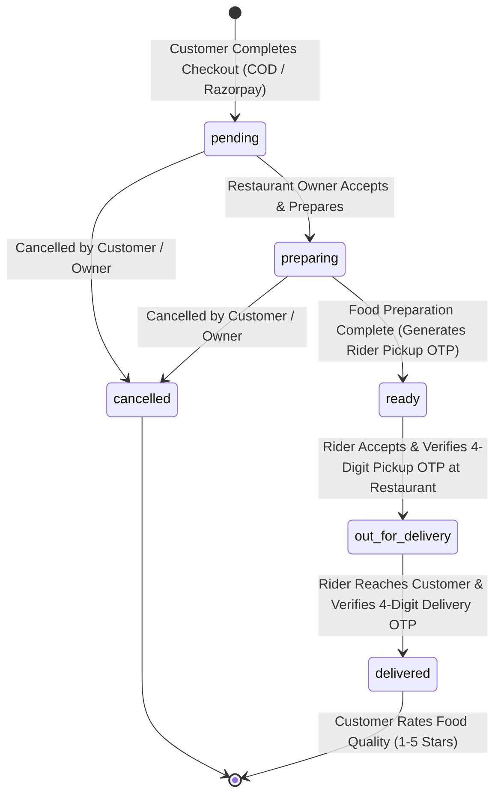

#  FoodExpress — Full-Stack Real-Time Food Delivery Platform


**FoodExpress** is a full-stack, role-based food delivery web application built with the **MERN Stack (MongoDB, Express.js, React.js, Node.js)**. It connects **Customers**, **Restaurant Owners**, **Delivery Partners (Riders)**, and **System Administrators** in a seamless ecosystem featuring live map routing, dual-OTP delivery verification, Razorpay payment integration, and real-time order tracking.

---

## Authors & Developers

* **Rishabh Verma**
* **Krish Khandelwal**

---

## Key Features by Role

### 1. Customer (`customer`)
* **Browse & Search:** Explore Admin-approved and currently open restaurants, filter dishes by category or Veg/Non-Veg tags, and view restaurant/dish ratings.
* **Single-Restaurant Cart Guard:** Enforces ordering from one restaurant at a time with persistent cart state (`localStorage`) and real-time bill calculation (Subtotal + $5\%$ Tax + ₹$40$ Delivery Fee).
* **Interactive Map Checkout:** Pinpoint delivery locations using a draggable Leaflet map marker or one-click GPS detection (**Upload Current Location**), automatically reverse-geocoded into English addresses via OpenStreetMap Nominatim.
* **Flexible Payments:** Support for both **Cash on Delivery (COD)** and **Online Payment** powered by **Razorpay** (UPI, Cards, NetBanking) with server-side HMAC SHA-256 signature verification.
* **Live Order Tracking & OTP Security:**
  * View real-time road routes and distance/ETA between the assigned Delivery Rider and customer doorstep using **OSRM (Open Source Routing Machine)**.
  * Receive a unique 4-digit **Delivery Verification OTP** (`customerOtp`) to share with the rider upon arrival.
* **Order Cancellation & Food Quality Ratings:**
  * Cancel orders while they are in `pending` or `preparing` status.
  * Rate food quality ($1$ to $5$ stars) and leave reviews once delivered, dynamically updating average ratings for both the restaurant and individual menu items.

### 2. Restaurant Owner (`owner`)
* **Vendor Onboarding & Status Alerts:** Register with restaurant details. Newly registered shops start as `pending` until approved by the Admin, with clear dashboard status banners for `pending`, `approved`, and `rejected` states.
* **Menu Management:** Create, edit, and delete dishes, toggle real-time stock availability (`Available` / `Sold Out`), classify items as `Veg` or `Non-Veg`, and upload dish images directly to **Cloudinary**.
* **Order Processing & Pickup OTP:**
  * Manage incoming orders through `pending` $\rightarrow$ `preparing` $\rightarrow$ `ready`.
  * Automatically generates a 4-digit **Restaurant Pickup Code** (`riderOtp`) to verify the Delivery Rider before handing over the package.
* **Monthly Revenue Analytics:** Dedicated **Monthly Revenue Report** modal in the navigation bar showing month-by-month revenue breakdowns, delivered vs. in-progress earnings, and item-level tax calculations (Menu Subtotal + $5\%$ Tax, excluding the ₹$40$ rider delivery fee).
* **Restaurant Settings:** Update shop details, toggle Open/Closed status, and pin exact restaurant coordinates on an interactive map.

### 3. Delivery Partner / Rider (`rider`)
* **Available Order Pool:** View all `ready` orders waiting for pickup along with restaurant details, customer contact info, ₹$40$ flat delivery earnings, and menu item costs.
* **Two-Stage Turn-by-Turn Map Navigation:**
  * **Step 1 (Rider $\rightarrow$ Restaurant):** Displays the road route to the restaurant. The rider enters the 4-digit **Pickup Code** (`riderOtp`) provided by the Restaurant Owner to unlock the customer route and transition the order to `out for delivery`.
  * **Step 2 (Restaurant $\rightarrow$ Customer):** Displays the road route to the customer's address. The rider enters the 4-digit **Customer Delivery OTP** (`customerOtp`) at the doorstep to mark the order `delivered`.
* **Live GPS Synchronization:** Automatically streams live browser geolocation (`navigator.geolocation.watchPosition`) and supports manual one-click GPS syncing.

### 4. System Administrator (`admin`)
* **Auto-Seeded Admin & Categories:** Automatically seeds the primary Admin account and 8 default food categories (`Starter`, `Main Course`, `Breads`, `Rice & Biryani`, `Chinese`, `Burgers & Pizza`, `Beverages`, `Dessert`) on server startup.
* **Vendor Approval Workflow:** Dedicated panel highlighting newly registered restaurants awaiting approval, with instant **Approve** and **Reject** controls.
* **Category Management:** Dynamically add or remove platform-wide food categories.
* **Platform Oversight:** Monitor KPI metrics, inspect all orders (including customer ratings and reviews), and view all registered users across roles.

---

## Order Lifecycle & State Machine



---

## Tech Stack

| Layer | Technologies Used |
| :--- | :--- |
| **Frontend** | React 19, Vite 8, Tailwind CSS v4, React Router DOM v7, Axios, Lucide React |
| **Maps & Routing** | Leaflet, React-Leaflet, OpenStreetMap TileLayer, OSRM Routing API, Nominatim Reverse Geocoding |
| **Backend** | Node.js, Express.js 5, ES Modules (`type: "module"`) |
| **Database** | MongoDB, Mongoose 9 |
| **Authentication** | JWT (`accessToken` & `refreshToken` in HttpOnly cookies), `bcryptjs`, Google Identity Services (OAuth 2.0) |
| **Payments & Media** | Razorpay SDK (Orders + Signature Verification), Multer + Cloudinary v2 |

---

## Project Structure

```text
FoodExpress/
├── backend/
│   ├── config/
│   │   ├── cloudinary.js         # Cloudinary configuration & local temp file cleanup
│   │   ├── db.js                 # MongoDB connection setup
│   │   └── razorpay.js           # Razorpay instance initialization
│   ├── controllers/
│   │   ├── adminController.js    # Admin seeding, vendor approvals, categories & stats
│   │   ├── authController.js     # JWT auth, Google OAuth, profile & shop management
│   │   ├── menuController.js     # Dish CRUD, Cloudinary upload & shop menu queries
│   │   └── orderController.js    # Order lifecycle, Razorpay, dual-OTP & rating logic
│   ├── middleware/
│   │   └── authMiddleware.js     # Cookie-based JWT verification & role restriction
│   ├── models/
│   │   ├── Category.js           # Food category schema
│   │   ├── MenuItem.js           # Dish schema with ratings & availability
│   │   ├── Order.js              # Order schema with coordinates, OTPs & payment status
│   │   ├── Shop.js               # Restaurant schema with approval status & location
│   │   └── User.js               # User schema with bcrypt hashing & token methods
│   ├── public/                   # Temporary directory for Multer image uploads
│   ├── routes/
│   │   ├── adminRoutes.js        # /api/admin endpoints
│   │   ├── authRoutes.js         # /api/auth endpoints
│   │   ├── menuRoutes.js         # /api/menu endpoints
│   │   └── orderRoutes.js        # /api/orders endpoints
│   ├── app.js                    # Express app, CORS, cookies & route mounting
│   ├── package.json
│   └── server.js                 # Entry point, DB connection & initial seeding
│
└── frontend/
    └── food-delivery/
        ├── public/
        ├── src/
        │   ├── api/
        │   │   ├── axios.js      # Axios instance with 401 token-refresh interceptor
        │   │   ├── authApi.js
        │   │   ├── menuApi.js
        │   │   └── orderApi.js
        │   ├── components/
        │   │   ├── Cart/         # CartDrawer.jsx & CartItem.jsx
        │   │   ├── Layout/       # Navbar.jsx (with Owner Monthly Revenue Modal)
        │   │   └── Maps/         # LocationMap.jsx (Leaflet + OSRM live routing)
        │   ├── context/
        │   │   ├── AuthContext.jsx
        │   │   └── CartContext.jsx
        │   ├── pages/
        │   │   ├── Admin/        # AdminDashboard.jsx & VendorApprovals.jsx
        │   │   ├── Auth/         # Login.jsx & Register.jsx
        │   │   ├── Customer/     # Home.jsx, Checkout.jsx & TrackOrder.jsx
        │   │   ├── Delivery/     # DeliveryDashboard.jsx
        │   │   └── Owner/        # ShopDashboard.jsx & MenuManagement.jsx
        │   ├── utils/
        │   │   └── loadRazorpay.js
        │   ├── App.jsx
        │   ├── index.css
        │   └── main.jsx
        ├── index.html
        ├── package.json
        ├── vercel.json
        └── vite.config.js
```

---

## Getting Started (Local Setup)

### Prerequisites
* **Node.js** (v18+ recommended)
* **MongoDB** (Local instance or MongoDB Atlas URI)
* **Cloudinary Account** (for menu image uploads)
* **Razorpay Test Account** (for online checkout)
* **Google Cloud Console OAuth 2.0 Client ID** (for Google Sign-In)

### 1. Clone the Repository
```bash
git clone https://github.com/your-username/FoodExpress.git
cd FoodExpress
```

### 2. Setup & Run Backend
```bash
cd backend
npm install
npm run dev
```
The backend server will start on `http://localhost:5000` and automatically seed the default Admin account and food categories.

### 3. Setup & Run Frontend
Open a new terminal window:
```bash
cd frontend/food-delivery
npm install
npm run dev
```
The React application will launch at `http://localhost:5173`.

---

## API Endpoints Overview

### Authentication (`/api/auth`)
| Method | Endpoint | Access | Description |
| :--- | :--- | :--- | :--- |
| `POST` | `/api/auth/register` | Public | Register a Customer, Restaurant Owner, or Rider |
| `POST` | `/api/auth/login` | Public | Authenticate user & set HttpOnly JWT cookies |
| `POST` | `/api/auth/google` | Public | Authenticate or register via Google OAuth2 token |
| `POST` | `/api/auth/refresh-token` | Public | Refresh expired `accessToken` using `refreshToken` cookie |
| `POST` | `/api/auth/logout` | Public | Clear auth cookies & invalidate refresh token |
| `GET` | `/api/auth/me` | Protected | Get current logged-in user & associated shop |
| `PUT` | `/api/auth/profile` | Protected | Update user name and phone number |
| `GET` | `/api/auth/my-shop` | Owner | Fetch logged-in owner's restaurant details |
| `PUT` | `/api/auth/my-shop` | Owner | Update restaurant profile, open status & map coordinates |

### Menu & Restaurants (`/api/menu`)
| Method | Endpoint | Access | Description |
| :--- | :--- | :--- | :--- |
| `GET` | `/api/menu` | Public | Get all available dishes from approved & open shops |
| `GET` | `/api/menu/categories` | Public | Get all food categories |
| `GET` | `/api/menu/shops` | Public | Get all Admin-approved restaurants |
| `GET` | `/api/menu/shops/:shopId/menu` | Public | Get available menu items for a specific restaurant |
| `GET` | `/api/menu/my-menu` | Owner | Get all menu items belonging to the logged-in owner |
| `POST` | `/api/menu` | Owner | Create a new dish (with Multer + Cloudinary image upload) |
| `PUT` | `/api/menu/:id` | Owner | Update dish details or replace image |
| `PATCH` | `/api/menu/:id/toggle` | Owner | Toggle dish stock availability (`isAvailable`) |
| `DELETE` | `/api/menu/:id` | Owner | Delete a dish from the menu |

### Orders & Delivery (`/api/orders`)
| Method | Endpoint | Access | Description |
| :--- | :--- | :--- | :--- |
| `POST` | `/api/orders/create-razorpay-order` | Customer | Create a Razorpay order ID for online checkout |
| `POST` | `/api/orders` | Customer | Place a new order (verifies Razorpay signature & generates OTPs) |
| `GET` | `/api/orders/my-orders` | Customer | Get order history for the logged-in customer |
| `GET` | `/api/orders/owner-orders` | Owner | Get incoming & past orders for the owner's restaurant |
| `GET` | `/api/orders/rider/available` | Rider | Get unassigned `ready` orders & rider's active deliveries |
| `GET` | `/api/orders/:id` | Protected | Get detailed order info for live tracking |
| `PUT` | `/api/orders/:id/status` | Owner | Update order status (`preparing`, `ready`, `cancelled`) |
| `PUT` | `/api/orders/:id/cancel` | Customer | Cancel order (allowed during `pending` or `preparing`) |
| `POST` | `/api/orders/:id/rate` | Customer | Rate food quality ($1$–$5$ stars) & update shop/dish averages |
| `PUT` | `/api/orders/:id/accept-delivery` | Rider | Assign rider to a `ready` order & initialize rider coordinates |
| `PUT` | `/api/orders/:id/rider-location` | Rider | Stream live GPS coordinates (`lat`, `lng`) for active orders |
| `POST` | `/api/orders/:id/verify-pickup-otp` | Rider | Verify 4-digit `riderOtp` & mark order `out for delivery` |
| `POST` | `/api/orders/:id/verify-delivery-otp`| Rider | Verify 4-digit `customerOtp` & mark order `delivered` |

### Admin Control (`/api/admin`)
| Method | Endpoint | Access | Description |
| :--- | :--- | :--- | :--- |
| `GET` | `/api/admin/stats` | Admin | Get all users, shops, orders, and categories |
| `GET` | `/api/admin/pending-vendors` | Admin | Get all registered vendor shops |
| `PUT` | `/api/admin/vendor-status/:id` | Admin | Approve or reject a restaurant (`approved` / `rejected`) |
| `GET` | `/api/admin/categories` | Public | List all food categories |
| `POST` | `/api/admin/categories` | Admin | Create a new food category |
| `DELETE` | `/api/admin/categories/:id` | Admin | Delete a food category |

---

## License

This project is licensed under the **ISC License**. Developed with dedication by **Krish Khandelwal** and **Rishabh Verma**.